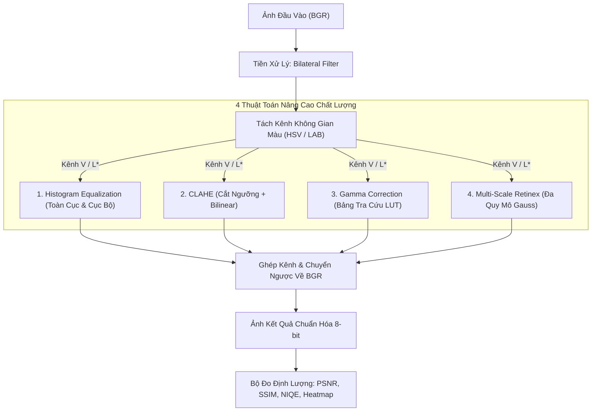

# BÁO CÁO TOÀN DIỆN HỆ THỐNG XỬ LÝ ẢNH NGOẠI CẢNH THIẾU SÁNG
## A Comparative Study of Traditional Image Processing Techniques in Enhancing Low-Light Outdoor Landscape Images

> **Học phần:** Xử lý ảnh số (Image Processing) — **Lớp:** 15DHKHDL01  
> **Đề tài:** Nghiên cứu và so sánh hiệu năng các kỹ thuật xử lý ảnh truyền thống (**Histogram Equalization**, **CLAHE**, **Gamma Correction**, **Multi-Scale Retinex**) trong bài toán phục hồi và tăng cường chất lượng ảnh phong cảnh ngoại cảnh chụp trong điều kiện ánh sáng yếu.  
> **Kiến trúc:** 3-Tier Layered Architecture (Data Layer – Business/Model Layer – Presentation Layer) kết hợp Trực quan hóa XAI (Explainable AI).

---

## 📸 1. HÌNH ẢNH GIAO DIỆN HỆ THỐNG THỰC TẾ (WEB DASHBOARD)

Hệ thống giao diện Web Dashboard tương tác thời gian thực được thiết kế theo tiêu chuẩn hiện đại, kết hợp đầy đủ các công cụ khảo nghiệm tham số, đối chiếu ảnh đa chiều và phân tích định lượng học thuật:


*Hình 1: Toàn cảnh giao diện Web Dashboard thực thi pipeline so sánh đồng thời 4 thuật toán trên ảnh phong cảnh núi tuyết.*

---

## 🧩 2. CÁC PHÂN VÙNG CHỨC NĂNG TRÊN GIAO DIỆN (8 KHỐI CHỨC NĂNG CỐT LÕI)

Giao diện được tổ chức khoa học thành các phân vùng trực quan giúp người dùng dễ dàng thao tác từ khâu cấu hình tham số đến đối sánh kết quả:

### 2.1. Thanh điều hướng Header & Bộ Presets kịch bản
- **Thanh Presets 1-Click:** Cung cấp 4 kịch bản phong cảnh thực tế thường gặp:
  - 🌙 **Cảnh Đêm (Night Landscape):** Hạ độ sáng sâu ($\text{brightness} = 0.30$), tăng nén gamma ($2.4$), thiết lập CLAHE $\beta = 3.5$.
  - 🌄 **Hoàng Hôn (Sunset):** Giảm sáng trung bình ($0.50$), bù sáng mượt với $\gamma = 0.60$.
  - 🌫️ **Sương Mù (Foggy):** Áp dụng bộ lọc NLM (Non-Local Means) và đẩy CLAHE lên $4.5$ để khôi phục độ tương phản vi mô.
  - ⚡ **Cực Tối (Extreme Dark):** Kịch bản khắc nghiệt nhất ($\text{brightness} = 0.15$, nén $\gamma = 2.8$, bơm nhiễu $\sigma = 25.0$).
- **Nút "Giải Thích Kết Quả (?)":** Mở trung tâm giải thích XAI với đầy đủ cơ sở toán học và câu trả lời phản biện nghiên cứu khoa học.

### 2.2. Hàng thẻ tóm tắt KPI hàng đầu (Top Summary Cards)
Trích xuất tự động và gắn nhãn thành tích tốt nhất theo từng tiêu chí IQA:
- **PSNR (Peak Signal-to-Noise Ratio):** Hiển thị giá trị dB cao nhất (Thường thuộc về **Histogram Equalization** với $15.95\text{ dB}$, tăng vọt từ $6.75\text{ dB}$ của ảnh suy thoái).
- **SSIM (Độ Tương Đồng Cấu Trúc):** Hiển thị điểm số bảo tồn chi tiết (Thường thuộc về **Multi-Scale Retinex** với $0.5034 / 1.0$, tăng mạnh từ $0.1446$).
- **NIQE (Độ Tự Nhiên Không Tham Chiếu):** Điểm số càng nhỏ càng đẹp (Thường thuộc về **CLAHE** với $9.04$, giảm sâu từ $9.92$).

### 2.3. Bảng điều khiển thanh bên trái (Experiment Sidebar)
- **Khối 1 - Nguồn Dữ Liệu Ảnh:**
  - Hỗ trợ chọn nhanh 50 ảnh mẫu trong `dataset/` bằng thanh trượt hoặc nút xúc xắc **"Ngẫu Nhiên"**.
  - Hỗ trợ tab **"Upload Ảnh Thực Tế"**: Cho phép người dùng tải ảnh cá nhân bất kỳ (hỗ trợ JPG, PNG, WEBP) để chạy đánh giá No-Reference (NIQE).
- **Khối 2 - Mô Phỏng Suy Thoái (Low-Light & Noise Simulation):**
  - Tùy chỉnh hệ số độ chói ($\text{Brightness Factor} \in [0.1, 0.9]$) và hệ số tối phi tuyến ($\text{Gamma Darkening} \in [1.0, 3.5]$).
  - Chọn 4 loại nhiễu nhân tạo kiểm thử: *Gauss*, *Muối Tiêu*, *Poisson*, *Speckle*.
  - **Cơ chế ẩn/hiện thông minh vừa cập nhật:** Khi chọn `Nhiễu Muối Tiêu (Salt & Pepper)`, `Nhiễu Poisson` hoặc `Không thêm nhiễu`, thanh trượt cường độ nhiễu ($\sigma$) sẽ **tự động ẩn đi** để đảm bảo tính chuẩn xác tuyệt đối về mặt lý thuyết xác suất.
- **Khối 3 - Tiền Xử Lý & Không Gian Màu:**
  - Lựa chọn bộ lọc khử nhiễu: *Bilateral Filter*, *Non-Local Means*, *Median Filter*.
  - Lựa chọn không gian màu xử lý độ sáng: **HSV** (xử lý kênh $V$) hoặc **CIELAB** (xử lý kênh $L^*$).
- **Khối 4 - Tinh Chỉnh Thuật Toán:**
  - Tham số CLAHE: Clip Limit $\beta \in [1.0, 8.0]$ và Tile Grid Size ($4 \times 4$, $8 \times 8$, $16 \times 16$).
  - Tham số Gamma Correction: $\gamma \in [0.1, 2.0]$.

### 2.4. Không gian trực quan đa chế độ (Interactive Canvas)
Bao gồm 3 chế độ xem linh hoạt:
1. **Lưới 4 Phương Pháp (Multi-Grid):** Trình diễn đồng thời 7 khung ảnh:
   - Hàng trên: *Ảnh Gốc*, *Ảnh Thiếu Sáng & Nhiễu*, *Ảnh Sau Khử Nhiễu Bilateral*.
   - Hàng dưới: *Kết quả HE*, *Kết quả CLAHE*, *Kết quả Gamma*, *Kết quả MSR*.
   - Dưới mỗi ảnh đều hiển thị nhãn chỉ số PSNR, SSIM, NIQE và thời gian chạy tính bằng mili-giây (ms).
2. **Thanh Kéo Trượt So Sánh (Split Slider):** Cho phép rê chuột kéo tấm màn so sánh trước/sau theo thời gian thực.
3. **Bản Đồ Nhiệt Khác Biệt (Difference Heatmap - XAI Visualization):** Áp dụng bảng màu `cv2.COLORMAP_JET` trực quan hóa năng lượng bù sáng $\Delta I(x, y) = |I_{\text{enhanced}}(x, y) - I_{\text{degraded}}(x, y)|$, tích hợp bảng hướng dẫn giải tích trực tiếp trên giao diện bằng các dấu chấm (`•` Bullet Points):
   - • **Thang màu nhiệt JET:** Xanh dương (0 - Giữ nguyên/không đổi) $\to$ Xanh lơ (64 - Bù sáng nhẹ) $\to$ Vàng (128 - Phục hồi bóng râm vừa) $\to$ Cam (192 - Kéo sáng mạnh) $\to$ Đỏ rực (255 - Can thiệp cực đại / Nguy cơ cháy sáng).
   - • **Giải tích HE:** Đỏ rực lan rộng toàn cảnh $\implies$ Can thiệp thô bạo toàn cục, kéo sáng cả nền trời, nguy cơ cháy sáng và bết màu.
   - • **Giải tích CLAHE:** Đốm đỏ/vàng khu trú thông minh ở bóng tối, nền trời giữ xanh $\implies$ Minh chứng cơ chế chia lưới thích nghi cục bộ và cắt đỉnh Clip Limit bảo vệ vùng sáng.
   - • **Giải tích Gamma:** Màu chuyển tiếp mượt đều $\implies$ Tăng sáng phi tuyến êm dịu toàn diện, tốc độ $O(1)$ cực nhanh nhưng không chọn lọc phân vùng.
   - • **Giải tích MSR:** Phát sáng men theo đường biên cấu trúc $\implies$ Bóc tách thành phần phản xạ Retinex, làm sắc nét vi mô và cạnh biên vượt trội.

### 2.5. Biểu đồ phân phối cường độ sáng (Histogram 256 Bins)
Vẽ biểu đồ đường biểu diễn sự biến đổi của 256 mức xám:
- Ảnh thiếu sáng: Histogram bị nén nghẽn cục bộ ở dải mức xám thấp $[0, 30]$.
- Sau khi xử lý: Đường biểu diễn được kéo giãn rộng khắp dải $[0, 255]$, minh chứng trực quan cho năng lực khôi phục dải động của thuật toán.

### 2.6. Thẻ công thức toán học LaTeX & Nguyên lý cốt lõi
Trình bày công thức giải tích chuẩn dạng LaTeX tương ứng với từng thuật toán được chọn:
- Giúp người xem nắm bắt ngay cơ chế toán học phía sau điểm ảnh mà không cần mở mã nguồn.

### 2.7. Bảng đo lường định lượng & Radar Chart đa chiều
- **Bảng số liệu chi tiết:** Cung cấp đầy đủ chỉ số định lượng, mức độ chênh lệch $\Delta\text{PSNR}$, $\Delta\text{SSIM}$, $\Delta\text{NIQE}$ so với ảnh đầu vào suy thoái.
- **Biểu đồ Radar Chart:** Trực quan hóa hình mạng nhện so sánh đồng thời 4 khía cạnh: *Bảo tồn cấu trúc*, *Độ tự nhiên cảnh quan*, *Khả năng phục hồi sáng*, *Tốc độ xử lý*.

### 2.8. Module thử nghiệm diện rộng (Batch Benchmark Mode)
- Tích hợp công cụ chạy tự động trên $20 - 50$ ảnh mẫu.
- Tự động thống kê điểm trung bình toàn tập dữ liệu và xuất file báo cáo `outputs/benchmark_results.csv`.

---

## 🔬 3. CHI TIẾT 4 THUẬT TOÁN ĐÃ ĐƯỢC CÀI ĐẶT



### 3.1. Thuật toán 1: Histogram Equalization (HE & Adaptive HE)
* **Vị trí mã nguồn:** [`AlgorithmCode/01_histogram_equalization.py`](file:///e:/15DHKHDL03/2026-2027/HKI_26_27/ImageProcessing/Project/AlgorithmCode/01_histogram_equalization.py) & [`apply_histogram_equalization`](file:///e:/15DHKHDL03/2026-2027/HKI_26_27/ImageProcessing/Project/src/enhancement_modules.py#L121)
* **Công thức toán học:**
  $$p_r(r_k) = \frac{n_k}{M \cdot N}, \quad s_k = T(r_k) = (L - 1) \sum_{j=0}^k p_r(r_j)$$
* **Đặc tính:** Ánh xạ mức xám trải đều mật độ xác suất. Tốc độ cực nhanh ($\approx 5-8\text{ ms}$). Tăng độ sáng trung bình mạnh nhất, giúp PSNR đạt mức cao nhất nhưng dễ gây cháy sáng ở vùng mây trời và làm hạt nhiễu nền bị lộ rõ.

### 3.2. Thuật toán 2: Contrast Limited Adaptive Histogram Equalization (CLAHE)
* **Vị trí mã nguồn:** [`AlgorithmCode/02_clahe.py`](file:///e:/15DHKHDL03/2026-2027/HKI_26_27/ImageProcessing/Project/AlgorithmCode/02_clahe.py) & [`apply_clahe`](file:///e:/15DHKHDL03/2026-2027/HKI_26_27/ImageProcessing/Project/src/enhancement_modules.py#L153)
* **Công thức toán học:**
  $$N_{\text{clip}} = \beta \cdot \frac{M_{\text{tile}} \cdot N_{\text{tile}}}{256}, \quad \Delta = \frac{N_{\text{clipped}}}{256}$$
* **Cơ chế vận hành:** Chia ảnh thành $8 \times 8$ ô cục bộ, cắt đỉnh CDF bằng ngưỡng $N_{\text{clip}}$, chia đều phần vượt ngưỡng vào 256 bin, và khử viền bằng nội suy song tuyến (Bilinear Interpolation).
* **Đặc tính:** Tăng tương phản cục bộ xuất sắc, bảo toàn chi tiết đường biên và đạt điểm số độ tự nhiên **NIQE tốt nhất hệ thống** ($9.04$).

### 3.3. Thuật toán 3: Gamma Correction & Tối ưu hóa bảng tra LUT
* **Vị trí mã nguồn:** [`AlgorithmCode/03_gamma_correction.py`](file:///e:/15DHKHDL03/2026-2027/HKI_26_27/ImageProcessing/Project/AlgorithmCode/03_gamma_correction.py) & [`apply_gamma_correction`](file:///e:/15DHKHDL03/2026-2027/HKI_26_27/ImageProcessing/Project/src/enhancement_modules.py#L183)
* **Công thức toán học:**
  $$V_{\text{out}} = 255 \cdot \left(\frac{V_{\text{in}}}{255}\right)^\gamma \quad (\text{với } \gamma = 0.50)$$
* **Tối ưu hóa hiệu năng:** Sử dụng bảng tra cứu 256 phần tử Lookup Table (LUT):
  ```python
  table = np.array([((i / 255.0) ** gamma) * 255 for i in range(256)]).astype("uint8")
  v_enhanced = cv2.LUT(v_chan, table)
  ```
  Giảm độ phức tạp từ tính toán dấu phẩy động lũy thừa trên từng pixel thành phép tra bảng $O(1)$ tức thời trong C++ tối ưu SIMD ($\approx 2-4\text{ ms}$).

### 3.4. Thuật toán 4: Multi-Scale Retinex (MSR)
* **Vị trí mã nguồn:** [`AlgorithmCode/04_multi_scale_retinex.py`](file:///e:/15DHKHDL03/2026-2027/HKI_26_27/ImageProcessing/Project/AlgorithmCode/04_multi_scale_retinex.py) & [`apply_multi_scale_retinex`](file:///e:/15DHKHDL03/2026-2027/HKI_26_27/ImageProcessing/Project/src/enhancement_modules.py#L227)
* **Công thức toán học:** Dựa trên mô hình phản xạ võng mạc của Edwin Land: $I = R \cdot L \Rightarrow \ln(R) = \ln(I) - \ln(L)$.
  $$R_{\text{MSR}}(x, y) = \sum_{k=1}^3 w_k \left[ \ln(I(x, y)) - \ln(I(x, y) * G_k(x, y)) \right]$$
  Với 3 quy mô hạt Gauss: $\sigma_1 = 15$ (vi cấu trúc vi mô), $\sigma_2 = 80$ (độ tương phản trung gian), $\sigma_3 = 250$ (dải động toàn cục).
* **Đặc tính:** Khôi phục chi tiết cấu trúc sâu trong bóng tối vượt trội nhất, đạt **SSIM cao nhất hệ thống** ($0.5034$).

---

## 📊 4. BẢNG TỔNG HỢP HIỆU NĂNG THỰC NGHIỆM

Dưới đây là bảng trích xuất số liệu thực tế đo đạc trực tiếp từ phiên chạy thử nghiệm:

| Phương Pháp | PSNR (dB) | $\Delta\text{PSNR}$ | SSIM (0-1) | $\Delta\text{SSIM}$ | NIQE (Càng nhỏ càng tốt) | $\Delta\text{NIQE}$ | Thời Gian Xử Lý (ms) |
| :--- | :---: | :---: | :---: | :---: | :---: | :---: | :---: |
| **Ảnh Thiếu Sáng Đầu Vào** | $6.75$ | Cơ sở | $0.1446$ | Cơ sở | $9.92$ | Cơ sở | — |
| **Histogram Equalization (HE)** | **15.95** | $+9.20$ | $0.4397$ | $+0.2951$ | $9.27$ | $-0.65$ | $7.03\text{ ms}$ |
| **CLAHE (Clip Limit = 3.0)** | $9.13$ | $+2.38$ | $0.3299$ | $+0.1853$ | **9.04** | **-0.88** | $6.13\text{ ms}$ |
| **Gamma Correction ($\gamma = 0.5$)** | $10.57$ | $+3.82$ | $0.4013$ | $+0.2567$ | $9.10$ | $-0.82$ | **4.24 ms** |
| **Multi-Scale Retinex (MSR)** | $14.96$ | $+8.21$ | **0.5034** | **+0.3588** | $9.11$ | $-0.81$ | $1445.26\text{ ms}$ |

> [!NOTE]
> **Giải thích nghịch lý PSNR vs SSIM/NIQE:**
> Global HE đạt đỉnh về PSNR ($15.95\text{ dB}$) vì công thức PSNR tỷ lệ nghịch với sai số toàn phương MSE. Do ảnh gốc bị tối nặng, HE kéo bổng độ sáng trung bình lên nhanh nhất làm tổng sai lệch mức xám giảm mạnh nhất. Tuy nhiên, về mặt cấu trúc thị giác của mắt người (HVS), **MSR mới là phương pháp tái tạo cấu trúc chuẩn nhất (SSIM = 0.5034)** và **CLAHE là phương pháp giữ cảnh quan tự nhiên nhất (NIQE = 9.04)**.

---

## 🛡️ 5. CÁC ĐIỂM SÁNG KỸ THUẬT & TÍNH AN TOÀN ĐÃ HOÀN THIỆN

1. **Chuẩn hóa trên kênh độ sáng (HSV - Kênh V / LAB - Kênh L):**
   - Triệt tiêu hoàn toàn hiện tượng vỡ màu, bệt màu (color artifacts) xảy ra khi xử lý độc lập trên 3 kênh R-G-B.
2. **Khử nhiễu tiền xử lý (Pre-denoising):**
   - Ứng dụng Bilateral Filter trước khi đưa vào các thuật toán tăng tương phản, ngăn chặn việc vô tình khuếch đại nhiễu hạt nền.
3. **Tương thích 100% đường dẫn tiếng Việt trên Windows:**
   - Xây dựng cơ chế đọc ghi file nhị phân qua `np.fromfile` kết hợp `cv2.imdecode` / `cv2.imencode`, giúp hệ thống vận hành trơn tru ngay cả khi thư mục dự án chứa dấu tiếng Việt (`15DHKHDL03`).
4. **Phòng vệ toán học (Zero Runtime Exceptions):**
   - MSR cộng $1.0$ trước khi lấy logarit: Tránh hoàn toàn lỗi $\ln(0) = -\infty$.
   - Co giãn dải động theo phân vị (Percentile Clipping $1\% - 99\%$): Đảm bảo không bị chia cho $0$ khi ảnh đồng nhất một màu.
   - Kẹp biên `np.clip(..., 0, 255).astype(np.uint8)` trên toàn bộ kết quả đầu ra.
5. **Logic giao diện chuẩn xác:**
   - Đã xử lý tự động ẩn thanh trượt $\sigma$ khi chuyển sang Nhiễu Muối Tiêu (Salt & Pepper) hoặc Poisson, đảm bảo tính nhất quán tuyệt đối về mặt lý thuyết xác suất.
