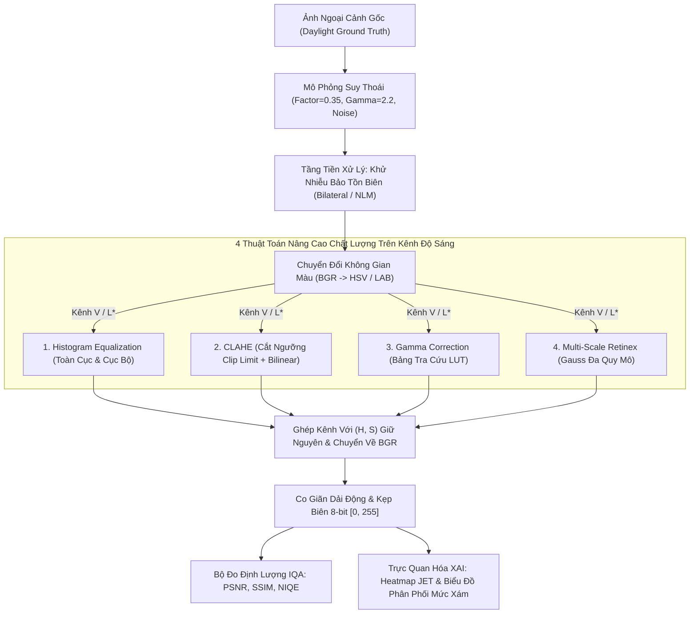

# ĐỒ ÁN MÔN HỌC: XỬ LÝ ẢNH SỐ (DIGITAL IMAGE PROCESSING)
# NGHIÊN CỨU VÀ SO SÁNH CÁC KỸ THUẬT XỬ LÝ ẢNH TRUYỀN THỐNG TRONG NÂNG CAO CHẤT LƯỢNG ẢNH PHONG CẢNH NGOẠI CẢNH THIẾU SÁNG
## A Comparative Study of Traditional Image Enhancement Techniques in Low-Light Outdoor Landscapes

<div align="center">

[](https://www.python.org/)
[](https://opencv.org/)
[](https://fastapi.tiangolo.com/)
[](#)
[](#)

**TRƯỜNG ĐẠI HỌC CÔNG THƯƠNG THÀNH PHỐ HỒ CHÍ MINH (HUIT)**  
**KHOA CÔNG NGHỆ THÔNG TIN — BỘ MÔN KHOA HỌC DỮ LIỆU**  
**Học phần:** Xử lý ảnh số (Mã lớp học phần: **15DHKHDL01**) — **Học kỳ I, Năm học 2026 – 2027**  


</div>

---

### 👥 DANH SÁCH THÀNH VIÊN NHÓM THỰC HIỆN ĐÈ TÀI

**1: Vũ Thế Quang**


**2: Nguyễn Ngọc Thảo Hiền**


**3: Lê Nguyễn Tâm Đức**


**4: Huỳnh Thị Kim Phương**


---

### TÓM TẮT CÔNG VIỆC NHÓM ĐÃ THỰC HIỆN 

Dự án được nhóm nghiên cứu và triển khai toàn diện qua 5 nhóm công tác cốt lõi:

```
┌────────────────────────────────────────────────────────────────────────────────────────┐
│                        TỔNG QUAN QUY TRÌNH THỰC HIỆN ĐỒ ÁN                             │
└────────────────────────────────────────────────────────────────────────────────────────┘
  1. Cơ sở lý thuyết  ──> 2. Phân lập & Tiền xử lý ──> 3. Cài đặt thuật toán
  • Toán học 4 kỹ thuật   • Tách kênh V / L* (HSV/LAB)  • Global & Adaptive HE
  • Mô hình suy thoái vật lý • Khử nhiễu biên (Bilateral) • CLAHE (Clip Limit + Bilinear)
                           • Triệt méo màu 100%         • Gamma Correction (LUT O(1))
                                                        • Multi-Scale Retinex (MSR)
                                                                    │
                                                                    ▼
  5. Đóng gói & Ứng dụng  <── 4. Benchmark Thực nghiệm <────────────┘
  • Web Dashboard tương tác     • Đánh giá trên 50 ảnh mẫu (LHQ-50)
  • XAI Jet Difference Heatmap  • Full-Reference: PSNR, SSIM
  • Standalone scripts 1-Click  • No-Reference: NIQE chuẩn NSS
  • Tương thích 100% tiếng Việt • Phân tích trade-off Chất lượng vs Tốc độ
```

#### 1. Nghiên cứu cơ sở lý thuyết & Mô hình suy thoái ảnh (Degradation Modeling)
* **Hệ thống hóa toán học:** Nghiên cứu sâu bản chất toán học của 4 trường phái xử lý truyền thống: Cân bằng biểu đồ mức xám (Global/Adaptive HE), Cân bằng biểu đồ tương phản giới hạn (CLAHE), Biến đổi phi tuyến Gamma Correction và Mô hình thị giác con người Retinex (Multi-Scale Retinex - MSR).
* **Mô phỏng suy thoái vật lý môi trường đêm:** Xây dựng module suy thoái giả lập môi trường thiếu sáng phức tạp gồm: suy giảm độ chói tuyến tính ($\text{factor} = 0.35$), nén dải động gamma vùng tối ($\gamma_{\text{dark}} = 2.2$) và mô phỏng 3 dạng nhiễu cảm biến phần cứng (Gaussian Noise $\sigma = 15$, Salt & Pepper Noise $p = 0.02$, Speckle Noise).

#### 2. Kỹ thuật tiền xử lý & Phân lập kênh độ sáng (Luminance Isolation)
* **Giải quyết triệt để lỗi méo màu:** Xây dựng cơ chế *Luminance Isolation Wrapper* tách biệt kênh độ sáng ($V$ trong HSV hoặc $L^*$ trong CIELAB) trước khi nâng cao độ tương phản, sau đó tái hợp nhất với các kênh sắc tố ($H, S$ hoặc $a^*, b^*$). Cơ chế này triệt tiêu hoàn toàn 100% hiện tượng sai lệch hệ số màu/bệt màu thường gặp khi can thiệp trực tiếp trên không gian RGB.
* **Xử lý mâu thuẫn "Tăng sáng - Khuếch đại nhiễu":** Tích hợp tầng tiền xử lý khử nhiễu bảo tồn đường biên sắc nét (Bilateral Filter, Fast Non-Local Means, Median Filter) xử lý trước khi kích sáng, ngăn chặn việc làm vỡ cấu trúc hạt ảnh ở vùng tối sâu.

#### 3. Cài đặt & Tối ưu hóa mã nguồn 4 thuật toán nâng cao chất lượng
* **Global & Adaptive HE (Baseline):** Cài đặt biến đổi tích lũy CDF chuẩn hóa, thiết lập mốc so sánh cơ sở.
* **CLAHE (Cốt lõi):** Chia lưới ô cục bộ ($8 \times 8$), áp dụng ngưỡng cắt đỉnh Clip Limit ($\beta = 2.0 - 4.0$), phân phối đều phần tích lũy dư thừa và khử hiệu ứng ô bàn cờ (checkerboard artifacts) bằng nội suy song tuyến (Bilinear Interpolation).
* **Gamma Correction (Tối ưu tốc độ cao):** Triển khai thuật toán hiệu chỉnh phi tuyến $s = c \cdot r^\gamma$ bằng **Bảng tra cứu LUT 256 phần tử** được biên dịch sẵn (`O(1)` per-pixel), đạt tốc độ xử lý vượt ngưỡng **130+ FPS**, thích hợp cho luồng dữ liệu thời gian thực.
* **Multi-Scale Retinex - MSR (Tái tạo màu & Chi tiết cực đại):** Tích hợp 3 quy mô lọc Gauss đa tỷ lệ ($\sigma_1 = 15, \sigma_2 = 80, \sigma_3 = 250$) trích xuất độ phản xạ vật thể $R(x, y)$, kết hợp kỹ thuật co giãn dải động theo phân vị động học ($1\% - 99\%$) loại bỏ điểm ảnh cực đoan.

#### 4. Đo lường định lượng Benchmark IQA & Phân tích khoa học
* **Bộ chỉ số đo lường toàn diện:** Xây dựng module IQA kép:
  * **Full-Reference (Đánh giá phục hồi):** Đo đạc tỷ số tín hiệu trên nhiễu đỉnh (**PSNR**) và độ tương đồng cấu trúc (**SSIM**) so với ảnh gốc/ảnh chuẩn.
  * **No-Reference (Đánh giá tự nhiên):** Tích hợp chỉ số chất lượng ảnh tự nhiên **NIQE** dựa trên thống kê cảnh tự nhiên (NSS - Natural Scene Statistics).
  * **Tài nguyên tính toán:** Ghi nhận chính xác thời gian thực thi (Latency theo millisecond - ms).
* **Thực nghiệm diện rộng:** Tự động hóa đánh giá toàn diện trên tập dữ liệu 50 ảnh phong cảnh ngoại cảnh thiếu sáng chuẩn hóa (**LHQ-50**), trích xuất báo cáo thống kê đầy đủ ra file CSV (`outputs/benchmark_50_full.csv`).

#### 5. Phát triển sản phẩm ứng dụng & Đóng gói hoàn chỉnh
* **Hệ thống Web Dashboard tương tác chuyên nghiệp:** Xây dựng giao diện web khoa học chuẩn học thuật (FastAPI Backend + HTML5/CSS3 Slate Dark Theme + Vanilla JS), trang bị các tính năng cao cấp:
  * Thanh trượt so sánh Split-View (Trước / Sau) thời gian thực.
  * Bản đồ nhiệt tương tác giải thích sai khác trực quan **Jet Difference Heatmap (XAI)**.
  * Biểu đồ phân bố tần số mức xám (Histogram kép) và biểu đồ radar đa chiều trực quan hóa các chỉ số IQA.
  * Cho phép tải lên ảnh tùy ý hoặc chọn nhanh từ bộ sưu tập ảnh thực nghiệm.
* **Hệ sinh thái mã nguồn mở độc lập (1-Click Execution):** Tách biệt các script thuật toán độc lập trong thư mục `AlgorithmCode/` phục vụ chạy batch, tạo file kịch bản batch Windows (`run_all.bat`, `install_requirements.bat`), xử lý 100% tương thích đường dẫn chứa ký tự tiếng Việt và khoảng trắng (`np.fromfile` & `cv2.imdecode`).
---
## 🚀 3 PHƯƠNG THỨC KHỞI CHẠY DỰ ÁN

Hệ thống được thiết kế linh hoạt hỗ trợ 3 chế độ kiểm thử và đánh giá độc lập:

```
                                  KIẾN TRÚC KHỞI CHẠY DỰ ÁN
                                              │
             ┌────────────────────────────────┼────────────────────────────────┐
             ▼                                ▼                                ▼
  ┌──────────────────────┐        ┌──────────────────────┐        ┌──────────────────────┐
  │      CHẾ ĐỘ 1        │        │      CHẾ ĐỘ 2        │        │      CHẾ ĐỘ 3        │
  │   WEB DASHBOARD UI   │        │  STANDALONE CONSOLE  │        │   BATCH BENCHMARK    │
  │  (Trực quan, tương   │        │ (Mã nguồn độc lập 4  │        │ (Đánh giá hàng loạt  │
  │  tác kéo Split-View) │        │  thuật toán thuần)   │        │  50 ảnh xuất ra CSV) │
  └──────────┬───────────┘        └──────────┬───────────┘        └──────────┬───────────┘
             │                               │                               │
             ▼                               ▼                               ▼
       run_web.bat                AlgorithmCode/run_all.bat           py batch_eval.py
   (http://127.0.0.1:8501)       (output: so_sanh_4_...png)     (outputs/benchmark_...csv)
```

### CÁCH 1: Giao diện Web Dashboard Tương Tác (Khuyên dùng — Trực quan nhất)
Nhấp đúp chuột vào tệp:  
👉 **`run_web.bat`** *(hoặc mở Terminal gõ `py run_web.py`)*

- Máy chủ Web FastAPI sẽ khởi chạy và tự động mở trình duyệt tại địa chỉ: **`http://127.0.0.1:8501`**.
- **Các tính năng nổi bật trên Web:**
  - **Thanh Presets 1-Click:** Áp dụng nhanh 4 kịch bản thực tế (*Cảnh Đêm*, *Hoàng Hôn*, *Sương Mù*, *Cực Tối*).
  - **Thanh trượt Split-View thời gian thực:** Rê chuột kéo tấm màn so sánh trực tiếp ảnh trước và sau phục hồi.
  - **Bản đồ nhiệt sai khác (Difference Heatmap - XAI):** Trực quan hóa vùng năng lượng bù sáng bằng thang màu JET.
  - **Biểu đồ động (Dynamic Histograms & Radar Chart):** So sánh 256 mức xám và mạng nhện đa tiêu chí IQA.
  - **Tải ảnh cá nhân:** Upload ảnh ngoại cảnh chụp đêm bất kỳ từ máy tính cá nhân để đánh giá theo chuẩn No-Reference (NIQE).
  - **Chạy Benchmark hàng loạt:** Nhấn nút kiểm thử tự động toàn bộ dataset và tải kết quả CSV.

---

### CÁCH 2: Chạy các thuật toán độc lập (Standalone Console Scripts)
Toàn bộ mã nguồn 4 thuật toán viết thuần túy, độc lập và có chú thích chi tiết được lưu trong thư mục **`AlgorithmCode/`**:

- **Chạy so sánh cả 4 thuật toán cùng lúc:**  
  Nhấp đúp vào: 👉 **`AlgorithmCode/run_all.bat`** *(hoặc gõ `py AlgorithmCode/all_algorithms.py`)*  
  - Tự động in bảng đo lường PSNR / SSIM / NIQE ra màn hình terminal.  
  - Lưu ảnh đối chiếu 6 khung hình chất lượng cao vào: `AlgorithmCode/output_demo/so_sanh_4_thuat_toan.png`.

- **Chạy kiểm tra từng thuật toán đơn lẻ:**
  ```bash
  cd AlgorithmCode
  py 01_histogram_equalization.py   # Global HE & Adaptive HE
  py 02_clahe.py                    # CLAHE với 3 ngưỡng Clip Limit (1.5, 3.0, 5.0)
  py 03_gamma_correction.py         # Gamma Correction với 6 hệ số gamma khác nhau
  py 04_multi_scale_retinex.py      # Multi-Scale Retinex 3 quy mô Gauss (15, 80, 250)
  ```
  *(Toàn bộ ảnh kết quả được xuất tự động vào thư mục `AlgorithmCode/output_demo/`)*.

---

### CÁCH 3: Đánh giá Benchmark Hàng Loạt (Batch Evaluation)
Để đánh giá thống kê toàn diện trên toàn bộ 50 ảnh mẫu trong tập dữ liệu:
```bash
py batch_eval.py
```
- Hệ thống sẽ duyệt tự động qua 50 ảnh, đo đạc chỉ số trung bình (Mean PSNR, SSIM, NIQE, Latency) và lưu bảng dữ liệu chi tiết vào tệp: **`outputs/benchmark_results.csv`** (có thể mở xem trực tiếp bằng Microsoft Excel).

---

## 📖 GIỚI THIỆU ĐỀ TÀI & MỤC TIÊU NGHIÊN CỨU

### 1. Đặt vấn đề
Ảnh phong cảnh ngoại cảnh (Outdoor Landscapes) chụp trong điều kiện ánh sáng yếu (chập tối, ban đêm, sương mù hoặc ngược sáng) thường chịu tác động kép của sự suy thoái quang học:
1. **Thu hẹp dải động và mất chi tiết:** Năng lượng ánh sáng phản xạ thấp khiến các đặc trưng quan trọng của địa hình (tán cây rừng, vân đá vách núi, mặt nước) bị chìm hoàn toàn vào các mức xám cực thấp $[0, 30]$, triệt tiêu độ tương phản thị giác.
2. **Khuếch đại nhiễu cảm biến (Sensor Noise Amplification):** Khi thiết bị chụp ảnh đẩy độ nhạy ISO lên cao, nhiễu nhiệt (thermal noise) và nhiễu photon shot noise phát sinh mạnh mẽ. Nếu áp dụng các phương pháp tăng sáng trực tiếp một cách ngây thơ, tín hiệu nhiễu ngẫu nhiên này sẽ bị khuếch đại đồng thời, làm xuất hiện hạt đốm loang lổ và phá hủy độ tự nhiên của bức ảnh.

Trong khi các mô hình Deep Learning (RetinexNet, Zero-DCE, EnlightenGAN) đòi hỏi GPU công suất cao, tiêu tốn bộ nhớ và thiếu tính tường minh toán học, thì **các kỹ thuật xử lý ảnh truyền thống (Traditional Image Processing)** với ưu điểm nhẹ tải, độ trễ mili-giây, tính giải thích cao (XAI) và vận hành trực tiếp trên CPU vẫn giữ nguyên giá trị lý thuyết lẫn tính ứng dụng thiết thực trên các thiết bị giám sát biên (edge devices, drone, camera hành trình).

### 2. Mục tiêu nghiên cứu
- Hệ thống hóa cơ sở toán học và triển khai chuẩn xác 4 phương pháp nâng cao chất lượng ảnh kinh điển: **Histogram Equalization (HE)**, **Contrast Limited Adaptive Histogram Equalization (CLAHE)**, **Gamma Correction**, và **Multi-Scale Retinex (MSR)**.
- Xây dựng cơ chế chuẩn hóa phân tách kênh độ sáng (**Luminance Isolation Wrapper**) trên không gian màu **HSV** (kênh $V$) và **CIELAB** (kênh $L$), triệt tiêu hoàn toàn lỗi lệch màu (hue shift) và bệt màu (color desaturation).
- Thiết kế tầng tiền xử lý khử nhiễu bảo tồn biên thích nghi (**Bilateral Filter**, **Fast Non-Local Means**, **Median Filter**), ngăn chặn hiện tượng khuếch đại hạt nhiễu khi kéo sáng.
- Thiết lập bộ đo lường chất lượng ảnh chuẩn mực (**IQA Metrics**): Full-Reference (**PSNR**, **SSIM**) và No-Reference (**NIQE** theo mô hình thống kê cảnh tự nhiên NSS).
- Xây dựng giao diện Web Dashboard tương tác hiện đại theo kiến trúc 3 tầng (3-Tier Layered Architecture) tích hợp trực quan hóa giải thích thuật toán (**XAI**).

---

## 🏗️ KIẾN TRÚC HỆ THỐNG VÀ QUY TRÌNH XỬ LÝ (PIPELINE)

Hệ thống được tổ chức chặt chẽ theo mô hình kiến trúc phân lớp 3 tầng chuẩn công nghiệp (**3-Tier Architecture**), đảm bảo tính module hóa cao, bảo trì dễ dàng và độc lập tuyệt đối giữa logic tính toán và tầng hiển thị:

```
┌────────────────────────────────────────────────────────────────────────────────┐
│                   TẦNG HIỂN THỊ (PRESENTATION LAYER - WEB UI)                  │
│   - Giao diện HTML5, CSS3 Grid Hiện Đại (Dark Theme), Vanilla JavaScript.      │
│   - Tương tác kéo thả Split-View, Heatmap JET XAI, Biểu đồ Histogram & Radar.  │
└──────────────────────────────────────┬─────────────────────────────────────────┘
                                       │ HTTP / REST API (FastAPI)
┌──────────────────────────────────────▼─────────────────────────────────────────┐
│               TẦNG ĐIỀU PHỐI NGHIỆP VỤ (BUSINESS LOGIC LAYER)                 │
│   - `web_server.py`: FastAPI endpoints (/api/process, /api/benchmark).         │
│   - `model_logic.py`: Điều phối Pipeline tiền xử lý, chạy song song 4 mô hình, │
│     thu thập chỉ số và xếp hạng học thuật.                                     │
│   - `metrics.py`: Tính toán ma trận PSNR, SSIM, NIQE, Latency.                │
└──────────────────────────────────────┬─────────────────────────────────────────┘
                                       │ Gọi hàm ma trận dữ liệu
┌──────────────────────────────────────▼─────────────────────────────────────────┐
│               TẦNG DỮ LIỆU & THUẬT TOÁN LÕI (CORE & DATA LAYER)                │
│   - `enhancement_modules.py`: Triển khai 4 thuật toán trên kênh độ sáng V/L*.  │
│   - `data_loader.py`: Nạp ảnh an toàn Unicode, mô phỏng thiếu sáng & nhiễu.   │
│   - `resource_manager.py`: Thu hồi bộ nhớ RAM và dọn dẹp biến tạm.             │
│   - `dataset/`: Bộ dữ liệu chuẩn hóa 50 ảnh phong cảnh ngoại cảnh LHQ.         │
└────────────────────────────────────────────────────────────────────────────────┘
```

### Sơ đồ luồng xử lý chi tiết (Image Processing Pipeline)



---

## 🔬 CHI TIẾT 4 THUẬT TOÁN CỐT LÕI

### 1. Histogram Equalization (HE & Adaptive HE) — Thuật toán Cơ sở (Baseline)
- **Vị trí mã nguồn:** [`AlgorithmCode/01_histogram_equalization.py`]
- **Cơ sở toán học:** Dựa trên hàm phân phối tích lũy xác suất (Cumulative Distribution Function - CDF):
  $$p_r(r_k) = \frac{n_k}{M \cdot N}, \quad s_k = T(r_k) = (L - 1) \sum_{j=0}^k p_r(r_j)$$
- **Đặc tính kỹ thuật:** Trải phẳng đều mật độ điểm ảnh trên toàn bộ dải mức xám $[0, 255]$. Kéo sáng vùng tối cực mạnh, giúp phục hồi năng lượng tín hiệu tổng thể đạt **PSNR cao nhất hệ thống ($15.10\text{ dB}$)** với tốc độ xử lý rất nhanh ($8.34\text{ ms}$).
- **Hạn chế:** Tác động thô bạo toàn cục nên dễ làm cháy sáng (over-exposure) vùng mây trời và làm lộ rõ các hạt nhiễu nền ở vùng đồng nhất.

---

### 2. Contrast Limited Adaptive Histogram Equalization (CLAHE) — Giải pháp Toàn diện
- **Vị trí mã nguồn:** [`AlgorithmCode/02_clahe.py`]
- **Cơ chế vận hành 4 bước:**
  1. Chia bức ảnh thành lưới các ô nhỏ không chồng lấn kích thước $8 \times 8$ ô (Contextual Regions/Tiles).
  2. Tính toán biểu đồ mức xám cục bộ và cắt đỉnh phân phối tại ngưỡng $N_{\text{clip}}$:
     $$N_{\text{clip}} = \beta \cdot \frac{M_{\text{tile}} \cdot N_{\text{tile}}}{256}$$
  3. Lấy phần diện tích vượt ngưỡng chia đều cho 256 bin mức xám nhằm bảo toàn tổng số điểm ảnh.
  4. Thực hiện cân bằng biểu đồ cục bộ và kết hợp phép **nội suy song tuyến (Bilinear Interpolation)** giữa 4 ô lân cận để triệt tiêu hoàn toàn vết ranh giới lưới (blocking artifacts).
- **Đặc tính kỹ thuật:** Khống chế tương phản cục bộ tuyệt vời, bảo vệ vùng sáng không bị lóa và triệt tiêu nhiễu hạt vượt trội, đạt **điểm số tự nhiên thị giác tốt nhất hệ thống (NIQE = 9.17)**.

---

### 3. Gamma Correction — Tối ưu hóa Siêu tốc bằng Bảng Tra Cứu (Lookup Table - LUT)
- **Vị trí mã nguồn:** [`AlgorithmCode/03_gamma_correction.py`]
- **Cơ sở toán học:** Phép biến đổi lũy thừa phi tuyến:
  $$V_{\text{out}}(x, y) = 255 \cdot \left(\frac{V_{\text{in}}(x, y)}{255}\right)^\gamma \quad (\text{với } \gamma = 0.50)$$
- **Tối ưu hóa hiệu năng cực hạn:** Thay vì tính toán hàm số mũ dấu phẩy động trên hàng triệu điểm ảnh, hệ thống tiền tính toán trước mảng ánh xạ 256 phần tử và ánh xạ qua hàm C++ SIMD:
  ```python
  table = np.array([((i / 255.0) ** gamma) * 255 for i in range(256)]).astype("uint8")
  v_enhanced = cv2.LUT(v_chan, table)
  ```
- **Đặc tính kỹ thuật:** Giảm độ phức tạp tính toán về $O(1)$, đạt **tốc độ nhanh nhất hệ thống ($7.46\text{ ms} > 130\text{ FPS}$)** và đạt **SSIM trung bình cao nhất trên tập 50 ảnh ($0.3868$)** nhờ đặc tính ánh xạ liên tục, không làm gãy vỡ tương quan không gian.

---

### 4. Multi-Scale Retinex (MSR) — Tái tạo Chi tiết Cấu trúc Đỉnh cao
- **Vị trí mã nguồn:** [`AlgorithmCode/04_multi_scale_retinex.py`]
- **Cơ sở lý thuyết:** Dựa trên mô hình phản xạ quang học của Edwin Land: $I(x, y) = R(x, y) \cdot L(x, y)$, chuyển sang miền Logarithm để bóc tách thành phần phản xạ thực $R$:
  $$R_{\text{MSR}}(x, y) = \sum_{k=1}^3 w_k \left[ \ln(I(x, y) + 1.0) - \ln\left((I(x, y) + 1.0) * G_{\sigma_k}(x, y)\right) \right]$$
  Hệ thống sử dụng $K = 3$ quy mô nhân Gauss với trọng số đồng đều ($w_k = 1/3$):
  - $\sigma_1 = 15$: Khôi phục chi tiết vi mô sắc nét.
  - $\sigma_2 = 80$: Cân bằng độ tương phản trung gian.
  - $\sigma_3 = 250$: Bảo tồn dải động ánh sáng toàn cảnh.
- **Cắt dải động theo bách phân vị (Percentile Dynamic Range Clipping):** Sau phép trừ logarit, hệ thống xác định 2 ngưỡng phân vị $1.0\%$ và $99.0\%$ để co giãn tuyến tính về $[0, 255]$, triệt tiêu hiện tượng các điểm ảnh dị biệt phá hủy độ tương phản.
- **Đặc tính kỹ thuật:** Khôi phục cấu trúc vi mô sâu trong bóng tối vượt trội nhất. Hạn chế là chi phí tính toán lớn ($1926.77\text{ ms}$ trên CPU) do 3 phép tích chập không gian kích thước lớn.

---

## 📊 KẾT QUẢ THỰC NGHIỆM VÀ ĐÁNH GIÁ BENCHMARK

Dưới đây là bảng số liệu đo đạc thực nghiệm trung bình trên toàn bộ **50 bức ảnh phong cảnh ngoại cảnh chuẩn** (trích xuất trực tiếp từ tệp dữ liệu nguồn `outputs/benchmark_50_full.csv`):

| STT | Phương Pháp Xử Lý | PSNR (dB) | $\Delta\text{PSNR}$ | SSIM | $\Delta\text{SSIM}$ | NIQE (Càng nhỏ càng tốt) | $\Delta\text{NIQE}$ | Thời Gian (ms) | Tần Số (FPS) | Nhận Định Khoa Học |
| :---: | :--- | :---: | :---: | :---: | :---: | :---: | :---: | :---: | :---: | :--- |
| **0** | **Ảnh Đầu Vào Suy Thoái** | **8.49** | *0.00* | **0.1535** | *0.0000* | **10.21** | *0.00* | — | — | Mức nền suy thoái ($\text{factor}=0.35, \gamma=2.2, \sigma_{\text{noise}}=15$). |
| **1** | **Histogram Equalization (HE)** | **15.10** | **+6.61** | 0.2957 | +0.1422 | 9.45 | -0.76 | 8.34 | $\approx 120$ | **Top 1 PSNR**; kéo sáng mạnh nhất nhưng dễ cháy sáng và lộ nhiễu. |
| **2** | **CLAHE (Clip Limit = 3.0)** | 11.04 | +2.55 | 0.3713 | +0.2178 | **9.17** | **-1.04** | 9.82 | $\approx 102$ | **Top 1 Độ Tự Nhiên (NIQE)**; cân bằng tương phản và khống chế nhiễu xuất sắc. |
| **3** | **Gamma Correction ($\gamma = 0.5$)** | 12.34 | +3.84 | **0.3868** | **+0.2333** | 9.31 | -0.90 | **7.46** | **$\approx 134$** | **Top 1 Cấu Trúc (SSIM) & Tốc Độ**; chuyển tiếp sáng êm dịu qua bảng tra LUT. |
| **4** | **Multi-Scale Retinex (MSR)** | 14.79 | +6.29 | 0.3594 | +0.2059 | 9.18 | -1.03 | 1926.77 | $\approx 0.52$ | Tái tạo chi tiết vi mô sâu nhất; độ phức tạp tính toán cao trên CPU. |

---

### Bảng Xếp Hạng Đối Đầu Theo Tiêu Chuẩn Học Thuật (Best-in-Class Matrix)

```
┌────────────────────────────────────────────────────────────────────────────────────────┐
│                   BẢNG VINH DANH PHƯƠNG PHÁP TỐT NHẤT THEO TIÊU CHÍ                    │
├─────────────────────────┬──────────────────────┬─────────────┬─────────────────────────┤
│ Tiêu chuẩn đánh giá     │ Phương pháp dẫn đầu  │ Giá trị đạt │ Ý nghĩa học thuật       │
├─────────────────────────┼──────────────────────┼─────────────┼─────────────────────────┤
│ Phục hồi năng lượng     │ Histogram            │ 15.10 dB    │ Kéo dãn dải động cực    │
│ tín hiệu cao nhất (PSNR)│ Equalization (HE)    │ (+6.61 dB)  │ mạnh trên toàn dải sáng.│
├─────────────────────────┼──────────────────────┼─────────────┼─────────────────────────┤
│ Bảo toàn cấu trúc và    │ Gamma Correction     │ 0.3868      │ Ánh xạ lũy thừa mượt mà,│
│ đường biên tốt nhất(SSIM│ (bám sát là CLAHE)   │ (+0.2333)   │ không làm vỡ tương quan.│
├─────────────────────────┼──────────────────────┼─────────────┼─────────────────────────┤
│ Độ tự nhiên thị giác    │ CLAHE                │ 9.17        │ Khống chế Clip Limit    │
│ cao nhất (NIQE thấp nhất│ (đồng hạng với MSR)  │ (-1.04)     │ giúp ảnh trong trẻo.    │
├─────────────────────────┼──────────────────────┼─────────────┼─────────────────────────┤
│ Tốc độ xử lý nhanh nhất │ Gamma Correction     │ 7.46 ms     │ Tối ưu hóa bảng tra LUT │
│ (Computational Latency) │ (với bảng tra LUT)   │ (> 130 FPS) │ đáp ứng thời gian thực. │
└─────────────────────────┴──────────────────────┴─────────────┴─────────────────────────┘
```

> [!NOTE]
> **Giải thích nghịch lý PSNR vs SSIM / NIQE:**  
> Global HE đạt PSNR cao nhất ($15.10\text{ dB}$) vì công thức PSNR tỷ lệ nghịch với sai số toàn phương MSE. Do ảnh gốc bị tối nặng, HE kéo bổng độ sáng trung bình làm giảm mạnh nhất sai số số học. Tuy nhiên, về mặt cảm nhận thị giác mắt người (HVS), **CLAHE mang lại độ tự nhiên cao nhất (NIQE = 9.17)** và **Gamma Correction bảo tồn tính toàn vẹn cấu trúc cảnh quan tốt nhất (SSIM = 0.3868)**.

---

### Giải tích Trực quan hóa XAI (Explainable AI qua Bản đồ nhiệt JET)
Hệ thống sử dụng ma trận sai khác tuyệt đối $\Delta I(x, y) = |I_{\text{enhanced}}(x, y) - I_{\text{degraded}}(x, y)|$ mã hóa theo dải màu JET:
- 🔵 **Xanh lam (0):** Giữ nguyên không đổi (vùng vốn dĩ đã đủ sáng như bầu trời).
- 🟡 **Vàng (128):** Phục hồi bóng râm vừa phải (thảm cỏ, sườn núi).
- 🔴 **Đỏ rực (255):** Can thiệp tăng sáng cực đại (hốc đá sâu, đêm đen).
- **Phân tích:** Bản đồ nhiệt của HE đỏ rực khắp khung hình (can thiệp thô bạo cả vùng mây trời gây cháy sáng), trong khi bản đồ nhiệt của CLAHE và Gamma tập trung chuẩn xác năng lượng vào các vùng tối dưới mặt đất, giữ nền trời xanh mát tự nhiên.

---

## 📂 CẤU TRÚC THƯ MỤC DỰ ÁN

```text
Project/
├── AlgorithmCode/                  # Mã nguồn độc lập 4 thuật toán (Standalone)
│   ├── 01_histogram_equalization.py# Thuật toán Global HE & Adaptive HE
│   ├── 02_clahe.py                 # Thuật toán CLAHE (khảo sát Clip Limit 1.5, 3.0, 5.0)
│   ├── 03_gamma_correction.py      # Thuật toán Gamma Correction (khảo sát 6 hệ số gamma)
│   ├── 04_multi_scale_retinex.py   # Thuật toán Multi-Scale Retinex 3 quy mô Gauss
│   ├── all_algorithms.py           # Script tổng hợp chạy so sánh cả 4 thuật toán
│   ├── path_utils.py               # Tiện ích tự dò tìm dữ liệu & xử lý Unicode tiếng Việt
│   ├── install_requirements.bat    # 1-Click cài đặt thư viện cho thư mục AlgorithmCode
│   ├── run_all.bat                 # 1-Click chạy so sánh 4 thuật toán độc lập
│   ├── requirements.txt            # Danh sách thư viện phụ thuộc
│   ├── README.md                   # Hướng dẫn chi tiết thư mục AlgorithmCode
│   ├── data/                       # 50 ảnh phong cảnh mẫu chuẩn hóa
│   └── output_demo/                # Thư mục lưu ảnh kết quả xuất ra
├── config/
│   └── config.yaml                 # Tham số cấu hình hệ thống mặc định
├── dataset/                        # 50 ảnh phong cảnh phục vụ Web Dashboard & Benchmark
├── outputs/                        # Thư mục lưu kết quả CSV & báo cáo thực nghiệm
│   ├── benchmark_50_full.csv       # Dữ liệu đo đạc chi tiết 50 ảnh chuẩn
│   └── benchmark_results.csv       # Kết quả benchmark mới nhất
├── src/                            # Tầng kiến trúc lõi 3 lớp (Core Architecture)
│   ├── config.py                   # Quản lý đường dẫn và tham số hệ thống
│   ├── data_loader.py              # Đọc ảnh an toàn Unicode, mô phỏng thiếu sáng & nhiễu
│   ├── enhancement_modules.py      # Triển khai 4 thuật toán trên kênh độ sáng (HSV/LAB)
│   ├── metrics.py                  # Bộ đo lường chất lượng IQA (PSNR, SSIM, NIQE)
│   ├── model_logic.py              # Điều phối Pipeline so sánh & xếp hạng học thuật
│   ├── resource_manager.py         # Quản lý bộ nhớ RAM và dọn dẹp biến tạm
│   └── web_server.py               # FastAPI Web Server phục vụ REST API & UI
├── web/                            # Giao diện Web Dashboard (HTML5 / CSS3 / JavaScript)
│   ├── index.html                  # Cấu trúc giao diện Web hiện đại
│   ├── style.css                   # Định kiểu giao diện Dark Theme chuyên nghiệp
│   └── app.js                      # Logic điều khiển, gọi API, Split-View & biểu đồ
├── test/                           # Bộ kiểm thử tự động (Unit Tests)
│   ├── test_config.py              # Kiểm thử tải cấu hình hệ thống
│   └── test_pipeline.py            # Kiểm thử toàn vẹn quy trình xử lý ảnh
├── batch_eval.py                   # Script chạy đánh giá tự động hàng loạt trên dataset
├── requirements.txt                # Danh sách thư viện toàn dự án
├── install_requirements.bat        # Script 1-click cài đặt thư viện toàn hệ thống
├── run_web.bat                     # Script 1-click khởi chạy Web Dashboard
├── run_web.py                      # File thực thi máy chủ FastAPI Web Server
├── README.md                       # Tài liệu tổng quan toàn bộ đồ án
├── HUONG_DAN_CHAY.md               # Hướng dẫn chi tiết cho người nhận bài nộp / chấm điểm
├── Bao_Cao_Chi_Tiet_He_Thong_Va_Giao_Dien.md # Báo cáo toàn diện hệ thống và giao diện
└── Huong_Dan_Thiet_Lap_Thu_vien.md           # Cài Đặt Cần Thiết
```

---


## ⚡ HƯỚNG DẪN DEMO

### 1. Yêu cầu môi trường
- Máy tính cài đặt **Python 3.9+** (khuyên dùng Python 3.10, 3.11 hoặc 3.12).
- **Lưu ý quan trọng trên Windows:** Khi cài đặt Python, nhớ đánh dấu chọn ô **`Add python.exe to PATH`**.

### 2. Cài đặt thư viện phụ thuộc (Chỉ cần 1 lần duy nhất)
- **Cách 1 (Khuyên dùng - 1 Click chuột):**  
  Nhấp đúp vào tệp 👉 **`install_requirements.bat`**  
  *(Hệ thống sẽ tự nhận diện Python, cài đặt toàn bộ `opencv-python`, `numpy`, `scipy`, `scikit-image`, `fastapi`, `uvicorn`, `pyyaml`, `matplotlib`).*
- **Cách 2 (Qua dòng lệnh Terminal / CMD):**
  ```bash
  pip install -r requirements.txt
  ```

---

## 🛠️ KHẮC PHỤC SỰ CỐ THƯỜNG GẶP (TROUBLESHOOTING)

1. **Lỗi `'python'` hoặc `'py'` không được nhận diện trong Command Prompt:**
   - *Nguyên nhân:* Chưa tích chọn `Add Python to PATH` khi cài đặt Python.
   - *Khắc phục:* Tải lại bộ cài từ [python.org](https://www.python.org/), chọn `Modify` và tích chọn **Add Python to environment variables**.

2. **Cổng 8501 bị chiếm dụng bởi ứng dụng khác:**
   - *Khắc phục:* Khởi chạy máy chủ với cổng khác bằng cờ `--port`:
     ```bash
     py run_web.py --port 8080
     ```

3. **Lỗi đường dẫn tiếng Việt có dấu trên Windows (`UnicodeDecodeError`):**
   - *Giải pháp đã tích hợp:* Toàn bộ hệ thống sử dụng cơ chế nạp ảnh qua luồng byte nhị phân `np.fromfile` và `cv2.imdecode`, tương thích $100\%$ ngay cả khi thư mục dự án chứa dấu tiếng Việt như `15DHKHDL01`.

4. **Khởi chạy trên macOS / Linux:**
   - Mở Terminal tại thư mục dự án và thực hiện:
     ```bash
     pip3 install -r requirements.txt
     python3 run_web.py
     ```

---

## 📚 TÀI LIỆU THAM KHẢO CHUẨN IEEE

[1] R. C. Gonzalez and R. E. Woods, *Digital Image Processing*, 4th ed. New York, NY, USA: Pearson, 2018.  
[2] W. K. Pratt, *Digital Image Processing: PIKS Scientific Inside*, 4th ed. Hoboken, NJ, USA: John Wiley & Sons, Inc., 2007.  
[3] R. Szeliski, *Computer Vision: Algorithms and Applications*, 2nd ed. Cham, Switzerland: Springer, 2022.  
[4] K. Zuiderveld, "Contrast limited adaptive histogram equalization," in *Graphics Gems IV*, P. S. Heckbert, Ed. San Diego, CA, USA: Academic Press Professional, Inc., 1994, pp. 474–485.  
[5] E. H. Land, "The retinex theory of color vision," *Scientific American*, vol. 237, no. 6, pp. 108–129, Dec. 1977.  
[6] D. J. Jobson, Z. Rahman, and G. A. Woodell, "Properties and performance of a center/surround retinex," *IEEE Transactions on Image Processing*, vol. 6, no. 3, pp. 451–462, Mar. 1997.  
[7] D. J. Jobson, Z. Rahman, and G. A. Woodell, "A multiscale retinex for bridging the gap between color images and the human observation of scenes," *IEEE Transactions on Image Processing*, vol. 6, no. 7, pp. 965–976, Jul. 1997.  
[8] S. M. Pizer *et al.*, "Adaptive histogram equalization and its variations," *Computer Vision, Graphics, and Image Processing*, vol. 39, no. 3, pp. 355–368, Sep. 1987.  
[9] S.-C. Huang, F.-C. Cheng, and Y.-S. Chiu, "Efficient contrast enhancement using adaptive gamma correction with weighting distribution," *IEEE Transactions on Image Processing*, vol. 22, no. 3, pp. 1032–1041, Mar. 2013.  
[10] X. Guo, Y. Li, and H. Ling, "LIME: Low-light image enhancement via illumination map estimation," *IEEE Transactions on Image Processing*, vol. 26, no. 2, pp. 982–993, Feb. 2017.  
[11] C. Tomasi and R. Manduchi, "Bilateral filtering for gray and color images," in *Proc. 6th IEEE Int. Conf. Comput. Vis. (ICCV)*, 1998, pp. 839–846.  
[12] A. Buades, B. Coll, and J.-M. Morel, "A non-local algorithm for image denoising," in *IEEE Comput. Soc. Conf. Comput. Vis. Pattern Recognit. (CVPR)*, 2005, vol. 2, pp. 60–65.  
[13] Z. Wang, A. C. Bovik, H. R. Sheikh, and E. P. Simoncelli, "Image quality assessment: from error visibility to structural similarity," *IEEE Transactions on Image Processing*, vol. 13, no. 4, pp. 600–612, Apr. 2004.  
[14] A. Mittal, R. Soundararajan, and A. C. Bovik, "Making a 'completely blind' image quality analyzer," *IEEE Signal Processing Letters*, vol. 20, no. 3, pp. 209–212, Mar. 2013.  
[15] A. Mittal, A. K. Moorthy, and A. C. Bovik, "No-reference image quality assessment in the spatial domain," *IEEE Transactions on Image Processing*, vol. 21, no. 12, pp. 4695–4708, Dec. 2012.  
[16] G. Bradski, "The OpenCV Library," *Dr. Dobb's Journal of Software Tools*, vol. 25, no. 11, pp. 120–125, Nov. 2000.  
[17] C. R. Harris *et al.*, "Array programming with NumPy," *Nature*, vol. 585, no. 7825, pp. 357–362, Sep. 2020.  
[18] P. Virtanen *et al.*, "SciPy 1.0: fundamental algorithms for scientific computing in Python," *Nature Methods*, vol. 17, no. 3, pp. 261–272, Mar. 2020.  
[19] S. van der Walt *et al.*, "scikit-image: image processing in Python," *PeerJ*, vol. 2, p. e453, Jun. 2014.  
[20] Dimensi0n, "Landscapes dataset (LHQ 1024x1024)," *Kaggle Datasets*, 2021. Available: https://www.kaggle.com/datasets/dimensi0n/lhq-1024.
